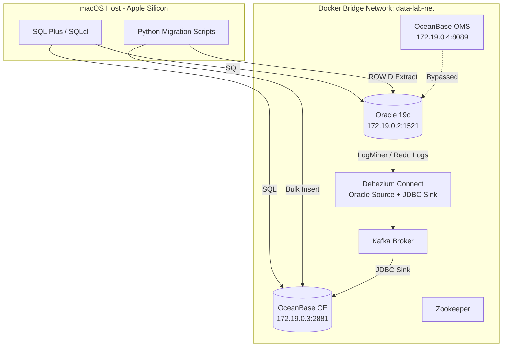

# Local Enterprise Data Lab on Apple Silicon (macOS)


A reproducible, containerized, enterprise-grade data lab built natively on Apple Silicon macOS. 

This repository is the companion codebase for the Medium series **"Setting Up a Local Enterprise Data Lab on macOS"** by Froilan Sia. It demonstrates cross-platform database migration, real-time Change Data Capture (CDC), and zero-downtime cutover strategies using Oracle, OceanBase, Debezium, and Kafka.

## 🏗 Architecture Overview

The lab simulates a real-world legacy-to-cloud migration. All database and streaming components run inside isolated Docker containers, communicating over a dedicated custom bridge network (`data-lab-net`). 



# 🚀 Quick Start

## 1. Prerequisites
* **Apple Silicon Mac** (M1/M2/M3/M4).
* **Docker Desktop** (Ensure Rosetta 2 is enabled for x86_64 emulation to run Oracle).
* **16GB RAM minimum** (Docker Desktop should be allocated at least 10GB).
* **Homebrew** installed.
* **Oracle Container Registry Account & Auth Token** (required for Part 2).

## 2. Clone & Configure
```bash
git clone https://github.com/froilan-sia/local-enterprise-data-lab.git
cd local-enterprise-data-lab
```

Create your environment file and fill in your passwords and registry tokens:
```bash
cp .env.example .env
# Edit .env with your credentials (e.g., ORACLE_PWD, OB_PWD)
```

## 3. Launch the Lab
The repository includes helper scripts to orchestrate the environment.

```bash
# Make the scripts executable
chmod +x scripts/*.sh python/*.sh

# Start the core infrastructure (Oracle, OceanBase, Kafka, Debezium)
./scripts/start_lab.sh
```

> 💡 **Note:** Initializing the Oracle 19c container under Rosetta 2 emulation can take 5-10 minutes.

To gracefully tear down the lab without losing your persistent data volumes:
```bash
./scripts/stop_lab.sh
```

---

# 📚 Series Summaries & Runbooks
If you are following along with the Medium articles, use the guides below to execute the specific commands for each phase.

### Part 1: Client Tooling on Apple Silicon
* **Summary:** Installs Oracle Instant Client (SQL\*Plus) and SQLcl natively on ARM64 macOS. Avoids Rosetta 2 emulation for host-side CLI tools and includes `rlwrap` configuration for command history and arrow-key support.
* **Install:** 
  ```bash
  brew install instantclient-basic instantclient-sqlplus sqlcl
  ```
* **Verify:** `sqlplus -v` and `sql -v`

### Part 2: Provisioning Oracle 19c & CDC
* **Summary:** Deploys Oracle 19c Enterprise Edition via Docker. Configures shared memory (`--shm-size=4g`), enables `ARCHIVELOG` mode, and sets up Supplemental Logging. Creates the `C##CDCATUSER` with specific LogMiner privileges for secure, zero-downtime replication.
* **Run:** 
  ```bash
  docker-compose -f docker-compose-cdc.yml up -d
  ```
  *(or via `start_lab.sh`)*
* **Verify:** Connect via SQL\*Plus to `localhost:1521/ORCLPDB1` and check `v$database` for `ARCHIVELOG` mode.

### Part 3: OceanBase CE & OMS Deployment
* **Summary:** Deploys OceanBase Community Edition with static IP pinning to prevent restart issues. Bypasses the official Chinese interactive install script for OMS by pre-creating a `config.yaml` and launching the Docker container via CLI.
* **Run:** Included in `start_lab.sh`.
* **Verify:** Access OMS Web UI at `http://localhost:8089` (Default user: `admin`).

### Part 4: Real-Time CDC with Debezium
* **Summary:** Builds a custom Debezium image containing the Oracle OJDBC driver (`Dockerfile.debezium`). Spins up Kafka, Zookeeper, and Debezium Connect. Configures the Oracle Source Connector (LogMiner) and OceanBase JDBC Sink Connector using the JSON files in the `connectors/` directory. Demonstrates dynamic DDL/DML replication.
* **Deploy Connectors:**
  ```bash
  curl -X POST -H "Content-Type: application/json" -d @connectors/oracle-source.json http://localhost:8083/connectors
  curl -X POST -H "Content-Type: application/json" -d @connectors/oceanbase-sink.json http://localhost:8083/connectors
  ```
* **Verify:** Create a table in Oracle; it automatically appears in OceanBase.

### Part 5: Full-Load & Zero-Downtime Cutover
* **Summary:** Simulates a production cutover. Uses Python (`oracledb`, `pymysql`) to perform parallel ROWID chunking for historical data. Handles `ORA-01555` via UNDO retention. Includes a reverse-sync Python daemon for fallback safety and finishes with Oracle decommissioning.
* **Execute Migration:**
  ```bash
  source python/capture_scn.sh
  python python/migrate_full_load.py
  ```
* **Start Fallback Daemon:**
  ```bash
  python python/reverse_daemon.py
  ```
* **Verify:** Run `SELECT COUNT(*)` in both databases to ensure 1:1 parity.

---

# 🧠 Architectural Decisions
This repository was designed to showcase enterprise architecture patterns in a local environment. Key decisions include:

* **Static IP Pinning (`data-lab-net`):** OceanBase's observer process records its bound IPv4 address into internal system catalogs. If Docker reassigns an IP upon restart, the database breaks. We solve this by using a custom bridge network with strict static IPs.
* **Infrastructure as Code (OMS):** Instead of relying on a fragile, interactive, Chinese-language terminal wizard to deploy OceanBase Migration Service (OMS), we inject a declarative `config.yaml` on launch.
* **Bypassing OMS for CDC:** While OMS is deployed, the Community Edition does not support Oracle as a source. We architect a modern, open-source alternative using Debezium + Kafka for LogMiner extraction.
* **Fallback Safety Net:** Real migrations require rollbacks. The Python reverse-sync daemon ensures that if the application misbehaves on OceanBase, transactions can be safely mirrored back to Oracle.
